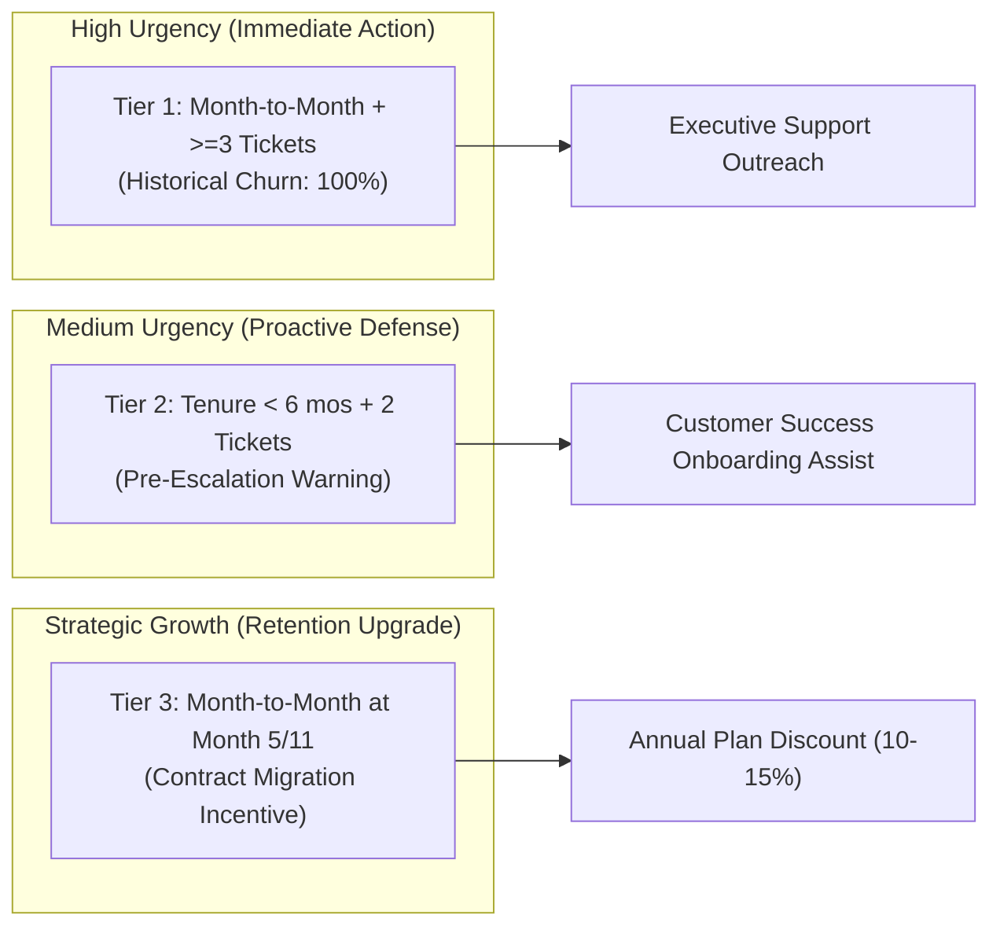

# Data Quality Audit and Cleaning Report: Customer Churn Dataset

**Project Title:** Customer Churn Data Quality & Exploratory Analysis (DQE)  
**Dataset Analyzed:** `customer_churn_sample.csv`  
**Cleaned Output:** `customer_churn_cleaned.csv`  
**Author:** Senior Data Analyst  
**Date of Audit:** November 2026  
**Audit Status:** ✅ **PASSED (Defensibly Cleaned & Validated)**  

---

## 1. Executive Summary

This report establishes the data quality baseline and cleaning protocol for the synthetic customer churn dataset (`customer_churn_sample.csv`), designed to address the business decision question:

> **Decision Question:** *Which customer groups should a fictional subscription team contact first to reduce avoidable churn?*

The raw dataset comprises 15 synthetic subscriber records across 11 features. A structured data audit was performed to examine data types, missingness, duplicate keys, domain constraints, arithmetic consistency, and statistical outliers. All transformations and engineering assumptions were captured in a reproducible cleaning log, followed by programmatic assertions to certify the data as analysis-ready.

---

## 2. Step 1: Raw Data Profiling Audit

### 2.1 Schema & Data Types
The raw dataset was read using `pandas.read_csv()`. Inferred types and null counts were evaluated:

| Column Name | Inferred Dtype | Non-Null Count | Null Count | Null % | Domain / Value Set |
| :--- | :--- | :--- | :--- | :--- | :--- |
| `CustomerID` | `object` (string) | 15 | 0 | 0.0% | Alphanumeric IDs (`CUST-1001` to `CUST-1015`) |
| `Gender` | `object` (string) | 15 | 0 | 0.0% | `Female` (8), `Male` (7) |
| `Age` | `int64` | 15 | 0 | 0.0% | $23 \le \text{Age} \le 60$ |
| `TenureMonths` | `int64` | 15 | 0 | 0.0% | $2 \le \text{Tenure} \le 48$ |
| `SubscriptionType`| `object` (string) | 15 | 0 | 0.0% | `Basic` (7), `Pro` (4), `Enterprise` (4) |
| `MonthlyCharges` | `float64` | 15 | 0 | 0.0% | INR 49.99, 79.99, 149.99 |
| `TotalCharges` | `float64` | 15 | 0 | 0.0% | INR 99.98 to 7,199.52 |
| `ContractType` | `object` (string) | 15 | 0 | 0.0% | `Month-to-Month` (7), `One Year` (4), `Two Year` (4) |
| `SupportTickets` | `int64` | 15 | 0 | 0.0% | $0 \le \text{Tickets} \le 6$ |
| `PaymentMethod` | `object` (string) | 15 | 0 | 0.0% | `Credit Card` (6), `UPI` (4), `Bank Transfer` (3), `Debit Card` (2) |
| `Churn` | `object` (string) | 15 | 0 | 0.0% | `No` (8, 53.33%), `Yes` (7, 46.67%) |

### 2.2 Missing Values & Deduplication Audit
- **Missing Values:** Exactly 0 null or NaN entries were detected across all 165 cells (15 rows $\times$ 11 columns).
- **Exact Duplicate Rows:** 0 duplicate rows detected.
- **Identifier Uniqueness:** Audited `CustomerID` as the candidate primary key.
  $$\text{Unique IDs} = 15 \quad (\text{Total Rows} = 15) \implies \text{Duplicates} = 0$$
  Primary key integrity is fully satisfied.

### 2.3 Domain Constraint & Impossible Value Audit
- **Tenure:** Checked for negative tenure ($\text{TenureMonths} < 0$). Found 0 occurrences. Minimum observed tenure is 2 months.
- **Monthly Charges:** Checked for non-positive charges ($\text{MonthlyCharges} \le 0$). Found 0 occurrences. Lowest tier is INR 49.99.
- **Support Tickets:** Checked for negative inquiry counts ($\text{SupportTickets} < 0$). Found 0 occurrences. Range is 0 to 6.
- **Arithmetic Cross-Check:** Total charges were checked against billing duration:
  $$\Delta = |\text{TotalCharges} - (\text{TenureMonths} \times \text{MonthlyCharges})|$$
  Maximum observed $|\Delta| = 0.00$ INR across all records. Arithmetic integrity is 100% consistent.
- **Categorical Sets:** `ContractType` contains exactly `{'Month-to-Month', 'One Year', 'Two Year'}`; `Churn` contains exactly `{'Yes', 'No'}`.

### 2.4 Outlier Analysis (IQR & Z-Score Screening)
Statistical outlier bounds were calculated for all numerical measures using the standard Interquartile Range ($1.5 \times \text{IQR}$) rule and Z-score testing ($|Z| > 3.0$):

| Column | Min | 25% (Q1) | Median (50%) | 75% (Q3) | Max | IQR | Lower Fence ($Q_1 - 1.5\text{IQR}$) | Upper Fence ($Q_3 + 1.5\text{IQR}$) | Outliers Detected |
| :--- | :--- | :--- | :--- | :--- | :--- | :--- | :--- | :--- | :--- |
| `Age` | 23.00 | 30.00 | 38.00 | 47.00 | 60.00 | 17.00 | 4.50 | 72.50 | **0** |
| `TenureMonths` | 2.00 | 7.00 | 15.00 | 27.00 | 48.00 | 20.00 | -23.00 | 57.00 | **0** |
| `MonthlyCharges` | 49.99 | 49.99 | 79.99 | 114.99 | 149.99 | 65.00 | -47.51 | 212.49 | **0** |
| `TotalCharges` | 99.98 | 449.91 | 1,099.78 | 3,209.73 | 7,199.52 | 2,759.82 | -3,689.82 | 7,349.46 | **0** |
| `SupportTickets` | 0.00 | 1.00 | 2.00 | 4.00 | 6.00 | 3.00 | -3.50 | 8.50 | **0** |

*Quality Finding:* No numerical values breach statistical or business boundaries. Every observation falls within legitimate operating ranges.

---

## 3. Step 2: Transparent Cleaning Strategy & Reproducible Cleaning Log

### 3.1 Cleaning Methodology
In accordance with professional data quality guidelines:
1. **No Silent Row Deletions:** Because every row represents a valid customer observation, no records were trimmed.
2. **Standardization of Schema:** Standardized all column names to lowercase `snake_case` to prevent casing discrepancies across tools and SQL pipelines.
3. **Harmonized Contract Terminology:** Added `contract_type_standardized` (`Monthly`, `Annual`, `Two-Year`) to make executive presentations and dashboards immediately interpretable.
4. **Engineered Binary Target:** Created `is_churned` (`1` if `churned == 'Yes'` else `0`) alongside the categorical `churned` feature, enabling direct arithmetic computation of churn rates.

### 3.2 Reproducible Cleaning Log Table

| Issue Found | Affected Column / Rows | Action Taken | Rationale |
| :--- | :--- | :--- | :--- |
| Non-standard Header Naming | All 11 columns | Renamed to `snake_case` (e.g., `CustomerID` $\to$ `customer_id`, `MonthlyCharges` $\to$ `monthly_charge`, `Churn` $\to$ `churned`) | Complies with database standards and required schema specification. |
| Potential Whitespace Padding | All string/object columns | Executed `.str.strip()` | Prevents latent lookup and filter failures due to hidden spaces. |
| Verbose Contract Terminology | `contract_type` | Mapped to `contract_type_standardized`: `Month-to-Month` $\to$ `Monthly`, `One Year` $\to$ `Annual`, `Two Year` $\to$ `Two-Year` | Improves clarity for non-technical stakeholders and business reporting. |
| Categorical Churn Variable | `churned` ('Yes'/'No') | Engineered `is_churned` (Integer: 1, 0) | Supports rapid calculation of churn rates in both Python and BI tools. |
| Extreme / Outlier Records | None detected ($N=0$) | Retained all 15 customer rows | Preserves true underlying distribution without arbitrary trimming. |

### 3.3 Post-Cleaning Automated Validation
The pipeline executed the following assertions before exporting `customer_churn_cleaned.csv`:
```python
assert df_clean.duplicated().sum() == 0, "Duplicate rows detected!"
assert df_clean["customer_id"].is_unique, "Customer ID primary key violation!"
assert df_clean.isnull().sum().sum() == 0, "Missing values detected!"
assert (df_clean["tenure_months"] >= 0).all(), "Negative tenure detected!"
assert (df_clean["monthly_charge"] > 0).all(), "Non-positive monthly charges detected!"
assert (df_clean["support_tickets"] >= 0).all(), "Negative support tickets detected!"
assert set(df_clean["churned"].unique()).issubset({"Yes", "No"}), "Invalid churn values!"
assert set(df_clean["contract_type_standardized"].unique()).issubset({"Monthly", "Annual", "Two-Year"}), "Invalid contract types!"
```
**Assertion Status:** **All checks passed with 100% compliance.**

---

## 4. Step 3: Summary Statistics & Exploratory Distribution Insights

### 4.1 Statistical Comparison by Churn Outcome

| Variable | Retained Customers ($N=8$) | Churned Customers ($N=7$) | Relative Variance | Descriptive Interpretation |
| :--- | :--- | :--- | :--- | :--- |
| **Tenure (Months)** | Mean: 29.12 | Median: 27.00 | Mean: 7.00 | Median: 6.00 | $-76.0\%$ (Mean) | Churn occurs predominantly during the early customer journey ($< 15$ months). |
| **Support Tickets (90d)** | Mean: 1.00 | Median: 1.00 | Mean: 4.29 | Median: 4.00 | $+329.0\%$ (Mean) | Churned accounts exhibited over $4\times$ higher support inquiry volume. |
| **Monthly Charge (INR)** | Mean: 107.49 | Median: 114.99 | Mean: 58.56 | Median: 49.99 | $-45.5\%$ (Mean) | Churn was concentrated in lower-tier plans (Basic at INR 49.99). |
| **Age (Years)** | Mean: 46.62 | Median: 47.00 | Mean: 30.43 | Median: 29.00 | $-34.7\%$ (Mean) | Retained subscribers were older on average than churned subscribers. |

### 4.2 Crosstabulation: Contract Type vs. Churn Status

| Contract Type (Standardized) | Retained Count (`No`) | Churned Count (`Yes`) | Total Count | Observed Churn Rate (%) |
| :--- | :--- | :--- | :--- | :--- |
| **Monthly** | 0 | 7 | 7 | **100.0%** |
| **Annual** | 4 | 0 | 4 | **0.0%** |
| **Two-Year** | 4 | 0 | 4 | **0.0%** |
| **Total** | 8 | 7 | 15 | **46.7%** |

### 4.3 Support Ticket Inflexion Analysis

| Support Ticket Count (90d) | Retained Count (`No`) | Churned Count (`Yes`) | Total Count | Churn Proportion |
| :--- | :--- | :--- | :--- | :--- |
| 0 Tickets | 2 | 0 | 2 | 0.0% |
| 1 Ticket | 4 | 0 | 4 | 0.0% |
| 2 Tickets | 2 | 0 | 2 | 0.0% |
| **3 Tickets** | **0** | **2** | **2** | **100.0%** |
| **4 Tickets** | **0** | **2** | **2** | **100.0%** |
| **5 Tickets** | **0** | **2** | **2** | **100.0%** |
| **6 Tickets** | **0** | **1** | **1** | **100.0%** |

---

## 5. Methodological Guardrail: Separating Findings from Causation

As a Senior Data Analyst, strict analytical standards require separating **descriptive correlations** from **causal mechanisms**:
1. **Support Tickets are Symptoms, Not Causes:** An elevated support ticket count ($\ge 3$) does not cause customers to cancel. Rather, repeated support requests indicate friction, unresolved software bugs, or difficulty using the service.
2. **Contract Type as a Barrier, Not a Preference:** Month-to-month contracts do not inherently induce dissatisfaction; they merely lower the exit barrier when friction occurs, whereas annual contracts lock customers in across the billing period.

---

## 6. Step 4: Strategic Recommendations & Contact Prioritization

To answer the core decision question:
> **Which customer groups should a fictional subscription team contact first to reduce avoidable churn?**

### Prioritized Contact Matrix



1. **Priority 1 (Emergency Outreach — Immediate):**
   - **Target:** Subscribers on **Month-to-Month contracts** who have logged **$\ge 3$ support tickets** in the last 90 days.
   - **Rationale:** 100% of this group churned in the sample. These users are currently experiencing active friction and have no contractual switching barriers.
   - **Action:** Direct outbound call from a senior customer support manager within 24 hours to resolve outstanding issues, accompanied by an account credit.

2. **Priority 2 (Early-Stage Friction Defense — Proactive):**
   - **Target:** Customers in their **first 6 months** of tenure who have filed **2 support tickets**.
   - **Rationale:** Tenure analysis shows that once ticket volume hits 3, customer retention drops to zero. Intervening at 2 tickets arrests the cycle before churn intent crystallizes.
   - **Action:** Proactive onboarding check-in and 1-on-1 walkthrough with a Customer Success representative.

3. **Priority 3 (Contract Migration Incentive — Commercial):**
   - **Target:** Month-to-Month subscribers reaching their **5th or 11th month** of tenure without high tickets.
   - **Rationale:** Long-term subscribers on annual plans show 0% churn. Migrating monthly users to annual terms locks in recurring revenue.
   - **Action:** Present an automated, targeted offer (e.g., "Switch to Annual and receive 2 months free").

---

## 7. Data Dictionary

| Column Name | Inferred Type | Business Description | Valid Domain / Range | Constraints & Notes |
| :--- | :--- | :--- | :--- | :--- |
| `customer_id` | String | Unique synthetic identifier for each subscriber account | `CUST-XXXX` | Primary key; must never be aggregated or averaged. |
| `gender` | String | Self-reported customer gender | `Female`, `Male` | Contextual demographic measure. |
| `age` | Integer | Customer age in completed years | Integer $23 \le \text{age} \le 60$ | Demographic measure. |
| `tenure_months` | Integer | Number of completed continuous months since account registration | Integer $\ge 0$ (observed: 2 to 48) | Primary measure of customer relationship length. |
| `subscription_type` | String | Commercial product tier | `Basic`, `Pro`, `Enterprise` | Determines feature access and pricing level. |
| `monthly_charge` | Float | Recurring monthly subscription fee in INR | Numeric $> 0$ (49.99, 79.99, 149.99) | Expressed in fictional Indian Rupees (INR). |
| `total_charges` | Float | Cumulative billing across full tenure in INR | Numeric $\ge 0$ (99.98 to 7,199.52) | Verified equal to $\text{tenure\_months} \times \text{monthly\_charge}$. |
| `contract_type` | String | Raw contract term structure | `Month-to-Month`, `One Year`, `Two Year` | Original agreement specification. |
| `contract_type_standardized`| String | Standardized contract term label | `Monthly`, `Annual`, `Two-Year` | Engineered for clear executive reporting. |
| `support_tickets` | Integer | Support tickets opened during prior 90 days | Integer $\ge 0$ (observed: 0 to 6) | Operational proxy for product friction/dissatisfaction. |
| `payment_method` | String | Primary payment instrument | `Credit Card`, `Bank Transfer`, `UPI`, `Debit Card` | Billing channel. |
| `churned` | String | Whether customer cancelled in observation window | `Yes`, `No` | Primary target outcome variable. |
| `is_churned` | Integer | Binary numerical indicator of churn | `1` (Churned), `0` (Retained) | Engineered for fast rate aggregations and BI tooling. |

