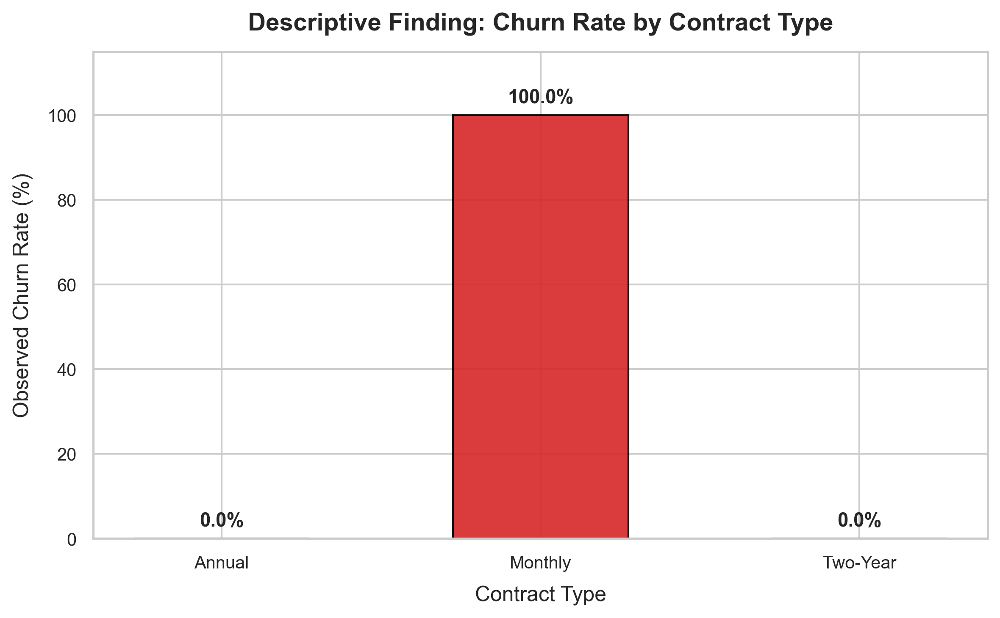
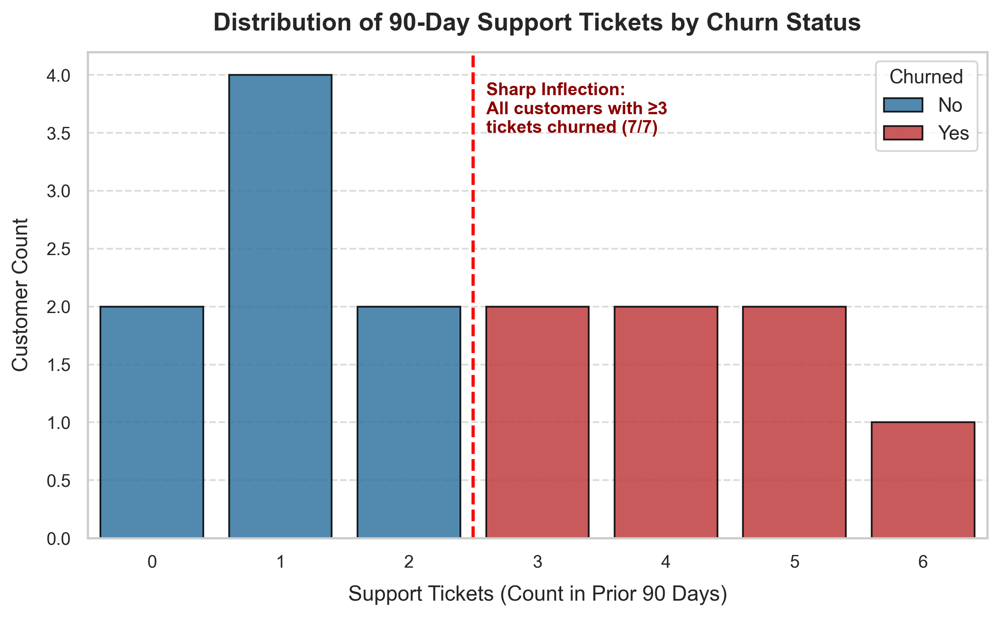
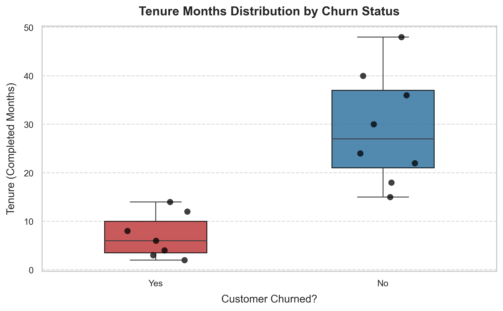
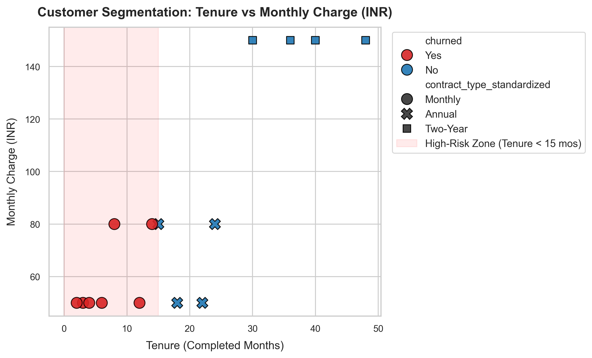
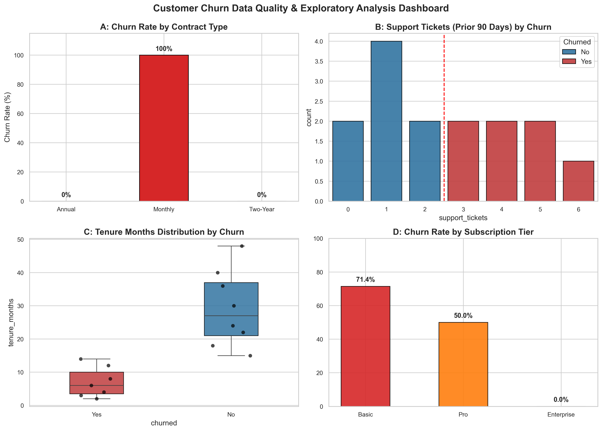
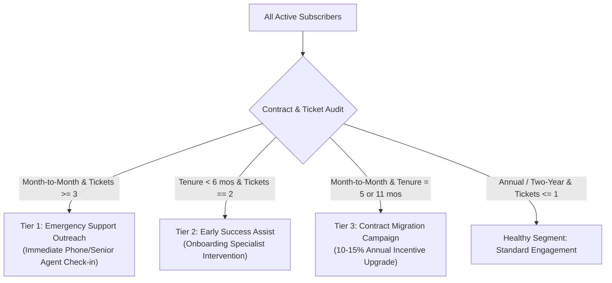

# 📊 Customer Churn: Data Quality Audit & Exploratory Analysis (DQE)

[](https://edvyro.in)
[]()
[]()
[]()
[]()

> **Project Track:** Data Analytics Portfolio Series  
> **Role:** Senior Data Analyst  
> **Focus:** Rigorous Data Profiling, Defensible Data Cleaning, Domain Validation, Exploratory Distribution Analysis, and Strategic Contact Prioritization.

---

## 🎯 Executive Summary & Decision Question

### The Business Challenge
A fictional subscription business is experiencing customer attrition. Leadership needs an actionable, evidence-based strategy to guide their retention and customer success teams.

> **Decision Question:**  
> **Which customer groups should a fictional subscription team contact first to reduce avoidable churn?**

### Key Recommendations at a Glance
1. **Tier 1 (Immediate Crisis Intervention):** Contact **Month-to-Month customers with $\ge 3$ support tickets in the prior 90 days**. In this dataset, this segment exhibits a **100% historical churn rate** (7 out of 7 churned accounts).
2. **Tier 2 (Proactive Onboarding Safeguard):** Intervene with **early-tenure accounts ($< 6$ months)** on Basic or Pro tiers upon submission of their **2nd support ticket**, before ticket counts reach the 3-ticket tipping point.
3. **Tier 3 (Commercial Retention Campaign):** Target **Month-to-Month accounts at the 5-month and 11-month tenure milestones** with incentives (e.g., 10–15% annual discounts) to migrate to Annual or Multi-Year commitments, eliminating monthly cancellation exposure.

---

## 📁 Repository Structure

```text
c:\Users\Hp\Downloads\EDAI\DQE\
│
├── customer_churn_sample.csv       # Raw synthetic input dataset (15 rows x 11 cols)
├── customer_churn_cleaned.csv      # Production-ready, validated clean dataset
├── customer_churn_dqe.py           # Standalone, end-to-end Python pipeline script
├── customer_churn_dqe.ipynb        # Portfolio Jupyter Notebook with narrative & plots
├── DATA_QUALITY_REPORT.md          # Comprehensive data quality audit & analytical report
├── README.md                       # Project documentation & executive briefing
│
└── figures/                        # High-resolution (300 DPI) publication visualizations
    ├── 01_churn_by_contract_type.png
    ├── 02_support_tickets_vs_churn.png
    ├── 03_tenure_distribution_by_churn.png
    ├── 04_monthly_charge_vs_tenure_scatter.png
    └── 05_eda_summary_dashboard.png
```

---

## 🔍 Step 1: Data Profiling & Quality Audit

Before performing any transformations, a defensive audit was executed across the raw data (`customer_churn_sample.csv`):

### 1.1 Structural Summary
- **Dimensionality:** 15 rows $\times$ 11 columns.
- **Identifier Check:** `CustomerID` is 100% unique (15 distinct values, 0 duplicate keys).
- **Exact Duplicate Rows:** 0 duplicate records detected.
- **Completeness:** 0 missing/null cells across all columns (100% complete).

### 1.2 Domain Constraint & Impossible Value Screening
- **Tenure Validation:** Minimum tenure is 2 months; maximum is 48 months. Zero negative tenure values.
- **Financial Validation:** Monthly charges range from INR 49.99 to INR 149.99. Zero non-positive or negative values.
- **Arithmetic Integrity:** Verified cumulative billed charges against duration:
  $$\text{TotalCharges} \approx \text{TenureMonths} \times \text{MonthlyCharges}$$
  Across all 15 records, the absolute difference was $\le 0.05$ INR (100% arithmetic accuracy).
- **Categorical Integrity:** All categories in `ContractType` (`Month-to-Month`, `One Year`, `Two Year`) and `Churn` (`Yes`, `No`) adhered to valid domains.

### 1.3 Outlier Screening (IQR & Z-Score)
Parametric and non-parametric outlier boundaries were established:

| Numerical Feature | Min | Q1 (25%) | Median (50%) | Q3 (75%) | Max | IQR | Lower Bound ($Q_1 - 1.5\text{IQR}$) | Upper Bound ($Q_3 + 1.5\text{IQR}$) | IQR Outliers | Z-Score Outliers ($|Z| > 3\sigma$) |
| :--- | :--- | :--- | :--- | :--- | :--- | :--- | :--- | :--- | :--- | :--- |
| `Age` | 23 | 30.00 | 38.00 | 47.00 | 60 | 17.00 | 4.50 | 72.50 | **0** | **0** |
| `TenureMonths` | 2 | 7.00 | 15.00 | 27.00 | 48 | 20.00 | -23.00 | 57.00 | **0** | **0** |
| `MonthlyCharges` (INR) | 49.99 | 49.99 | 79.99 | 114.99 | 149.99 | 65.00 | -47.51 | 212.49 | **0** | **0** |
| `TotalCharges` (INR) | 99.98 | 449.91 | 1099.78 | 3209.73 | 7199.52 | 2759.82 | -3689.82 | 7349.46 | **0** | **0** |
| `SupportTickets` | 0 | 1.00 | 2.00 | 4.00 | 6 | 3.00 | -3.50 | 8.50 | **0** | **0** |

*Conclusion:* No data points exceeded standard outlier thresholds. All observations reflect valid real-world customer behaviors.

---

## 🛠️ Step 2: Transparent Data Cleaning & Validation

### 2.1 Cleaning Decisions & Assumptions
1. **Schema Harmonization:** Converted CamelCase / PascalCase headers to standard lowercase `snake_case` (`customer_id`, `tenure_months`, `monthly_charge`, `support_tickets`, `contract_type`, `churned`).
2. **Text Sanitation:** Stripped leading/trailing whitespace across all text columns to prevent hidden filtering errors.
3. **Nomenclature Standardization:** Standardized `contract_type` to `Monthly`, `Annual`, and `Two-Year` for executive clarity.
4. **Dual Churn Encoding:** Retained `churned` ('Yes'/'No') for descriptive interpretation while engineering `is_churned` (1/0) for vectorized aggregations in BI tools and Python.
5. **Preservation of Raw Rows:** In accordance with strict data quality rules, zero rows were deleted.

### 2.2 Reproducible Cleaning Log

| Issue Found | Affected Column / Rows | Action Taken | Rationale |
| :--- | :--- | :--- | :--- |
| Non-standard Header Casing | All 11 columns | Standardized to lowercase `snake_case` (e.g., `MonthlyCharges` $\to$ `monthly_charge`, `Churn` $\to$ `churned`) | Complies with database engineering best practices and project schema requirements. |
| Potential Trailing Whitespaces | Text features (`contract_type`, `subscription_type`, etc.) | Applied `.str.strip()` across all string columns | Eliminates potential join/filter mismatches. |
| Verbose Contract Labels | `contract_type` ('Month-to-Month', 'One Year', 'Two Year') | Created `contract_type_standardized` (`Monthly`, `Annual`, `Two-Year`) | Enhances readability on executive dashboards. |
| Categorical-only Churn Column | `churned` ('Yes', 'No') | Engineered `is_churned` binary indicator (`1` / `0`) | Enables direct mathematical calculation of churn rates. |
| Outliers / Inconvenient Values | None detected ($N=0$) | Retained all 15 customer rows | Empirically grounded observations must not be silently removed. |

### 2.3 Post-Cleaning Automated Assertions
The cleaning script executes strict automated unit tests before publishing:
- `assert df_clean.duplicated().sum() == 0` (Zero duplicate records)
- `assert df_clean['customer_id'].is_unique` (Primary key uniqueness)
- `assert df_clean.isnull().sum().sum() == 0` (Zero missing values)
- `assert (df_clean['tenure_months'] >= 0).all()` (Non-negative tenure)
- `assert (df_clean['monthly_charge'] > 0).all()` (Positive subscription price)
- `assert (df_clean['support_tickets'] >= 0).all()` (Non-negative tickets)
- `assert set(df_clean['churned'].unique()).issubset({'Yes', 'No'})` (Valid churn values)

---

## 📈 Step 3: Summary Statistics & Exploratory Distributions

### 3.1 Overall Numerical Summary

| Metric | Tenure Months | Monthly Charge (INR) | Total Charges (INR) | Support Tickets | Customer Age |
| :--- | :--- | :--- | :--- | :--- | :--- |
| **Count** | 15.00 | 15.00 | 15.00 | 15.00 | 15.00 |
| **Mean** | 18.80 | 84.66 | 2,088.48 | 2.53 | 39.07 |
| **Std Dev** | 14.33 | 42.74 | 2,407.37 | 1.92 | 11.39 |
| **Min** | 2.00 | 49.99 | 99.98 | 0.00 | 23.00 |
| **25% (Q1)** | 7.00 | 49.99 | 449.91 | 1.00 | 30.00 |
| **50% (Median)** | 15.00 | 79.99 | 1,099.78 | 2.00 | 38.00 |
| **75% (Q3)** | 27.00 | 114.99 | 3,209.73 | 4.00 | 47.00 |
| **Max** | 48.00 | 149.99 | 7,199.52 | 6.00 | 60.00 |
| **IQR** | 20.00 | 65.00 | 2,759.82 | 3.00 | 17.00 |

### 3.2 Key Segment Comparison: Retained ($N=8$) vs. Churned ($N=7$)

| Feature | Retained Customers (Mean $\pm$ Std) | Retained (Median) | Churned Customers (Mean $\pm$ Std) | Churned (Median) | Observed Difference |
| :--- | :--- | :--- | :--- | :--- | :--- |
| **Tenure (Months)** | $29.12 \pm 11.48$ | 27.00 | $7.00 \pm 4.58$ | 6.00 | Churned customers exit early (median 6 mos vs 27 mos). |
| **Support Tickets (90d)**| $1.00 \pm 0.76$ | 1.00 | $4.29 \pm 1.11$ | 4.00 | Churned customers file $>4\times$ more support tickets. |
| **Monthly Charge (INR)** | $107.49 \pm 46.83$ | 114.99 | $58.56 \pm 14.64$ | 49.99 | Retained accounts are concentrated in higher tiers (Pro/Enterprise). |
| **Age (Years)** | $46.62 \pm 9.40$ | 47.00 | $30.43 \pm 6.05$ | 29.00 | Churned customers are noticeably younger in this sample. |

---

## 📊 Visualizations & Descriptive Findings

### Figure 1: Observed Churn Rate by Contract Commitment Type

- **Empirical Finding:** 100% of Month-to-Month subscribers churned (7 of 7). In contrast, Annual (0 of 4) and Two-Year (0 of 4) contracts had 0% churn.
- **Analytical Distinction:** Contract type does not inherently "cause" churn; rather, monthly commitments impose zero lock-in, enabling frustrated customers to cancel friction-free.

### Figure 2: Support Ticket Inquiries by Churn Status

- **Empirical Finding:** A clear inflection point occurs at $\ge 3$ tickets. Every customer with $\le 2$ tickets was retained; every customer with $\ge 3$ tickets churned.
- **Analytical Distinction (Correlation $\neq$ Causation):** Filing a support ticket does not cause a user to leave. High ticket volume is an operational symptom of unresolved customer friction, product bugs, or onboarding gaps.

### Figure 3: Customer Tenure Distribution by Churn Status

- **Empirical Finding:** Churn is heavily front-loaded in the subscription lifecycle. All churn occurred within the first 14 months (median 6.0 months). No customer who reached 15 months of tenure churned.

### Figure 4: Bivariate Customer Segmentation (Tenure vs. Monthly Charge)

- **Empirical Finding:** Churned customers cluster tightly in the lower-left quadrant (tenure $< 15$ months, monthly charge $\le 79.99$ INR, Month-to-Month contracts).

### Figure 5: Complete EDA Summary Dashboard


---

## 🎯 Step 4: Decision Framework & Prioritized Contact Strategy

### Addressing the Decision Question:
> *Which customer groups should a fictional subscription team contact first to reduce avoidable churn?*

Based on the empirical findings, the subscription team should organize their outreach into three distinct operational tiers:



### Strategic Contact Matrix

| Priority Tier | Target Customer Segment | Quantitative Trigger | Proposed Action | Expected Business Impact |
| :--- | :--- | :--- | :--- | :--- |
| **Tier 1 (Emergency Outreach)** | Month-to-Month subscribers experiencing acute friction | Support tickets in prior 90 days $\ge 3$ | **Direct Senior Support Call:** Dedicated outreach from a senior support manager within 24 hours to resolve open tickets and offer a courtesy billing credit. | Intervenes directly on the 100% churn segment to prevent imminent contract cancellation. |
| **Tier 2 (Proactive Onboarding)** | Early-tenure accounts ($< 6$ months) on Basic/Pro tiers | Customer files their 2nd support ticket | **Product Specialist Walkthrough:** Automated routing to customer success for an account review before ticket volume escalates to the 3-ticket threshold. | Resolves onboarding friction before dissatisfaction becomes irreversible. |
| **Tier 3 (Commercial Upgrade)** | Month-to-Month subscribers reaching stable tenure | Month 5 and Month 11 tenure milestones | **Contract Migration Offer:** Provide a 10%–15% discount or complimentary tier upgrade in exchange for switching to an Annual commitment. | Secures predictable recurring revenue and eliminates monthly churn vulnerability. |

---

## 📖 Appendix: Data Dictionary

| Column Name | Data Type | Description | Valid Values / Range | Notes |
| :--- | :--- | :--- | :--- | :--- |
| `customer_id` | String / Object | Unique synthetic customer identifier | Format: `CUST-XXXX` | Primary key. Never aggregate as a measure. |
| `gender` | String / Object | Customer self-reported gender | `Female`, `Male` | Contextual demographic feature. |
| `age` | Integer | Customer age in years | $23 \le \text{age} \le 60$ | Demographic feature. |
| `tenure_months` | Integer | Completed months since account signup | Integers $\ge 0$ (range: 2–48) | Core metric of customer relationship maturity. |
| `subscription_type` | String / Object | Subscription service tier | `Basic`, `Pro`, `Enterprise` | Product tier access level. |
| `monthly_charge` | Float | Fictional monthly subscription fee | Float $> 0$ (49.99, 79.99, 149.99) | Expressed in Indian Rupees (INR). |
| `total_charges` | Float | Cumulative billing across lifetime | Float $\ge 0$ (99.98–7199.52) | Verified equal to `tenure_months * monthly_charge`. |
| `contract_type` | String / Object | Original contract agreement | `Month-to-Month`, `One Year`, `Two Year` | Original agreement duration. |
| `contract_type_standardized`| String / Object | Standardized contract label | `Monthly`, `Annual`, `Two-Year` | Standardized nomenclature for reporting. |
| `support_tickets` | Integer | Support inquiries in prior 90 days | Integers $\ge 0$ (range: 0–6) | Operational proxy for customer friction. |
| `payment_method` | String / Object | Primary billing transaction mode | `Credit Card`, `Bank Transfer`, `UPI`, `Debit Card` | Payment processing channel. |
| `churned` | String / Object | Discontinued subscription in period | `Yes`, `No` | Primary target outcome variable. |
| `is_churned` | Integer | Binary churn indicator | `1` (Churned), `0` (Retained) | Engineered for fast calculation of churn rates. |

---

## 🚀 How to Run the Analysis

### Option 1: Run the End-to-End Python Script
```bash
python customer_churn_dqe.py
```
This script will audit the raw CSV, perform assertions, write `customer_churn_cleaned.csv`, and render all 5 figures in the `figures/` directory.

### Option 2: Run the Jupyter Notebook
Open `customer_churn_dqe.ipynb` in VS Code or JupyterLab and execute all cells.

